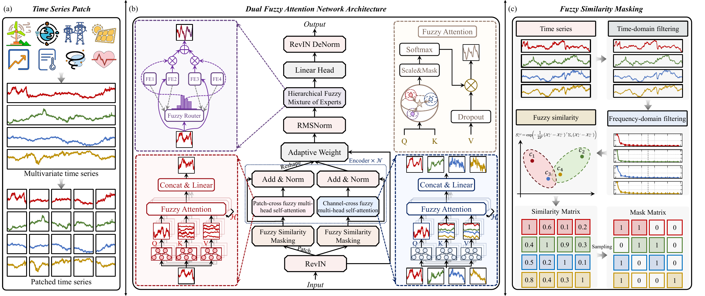
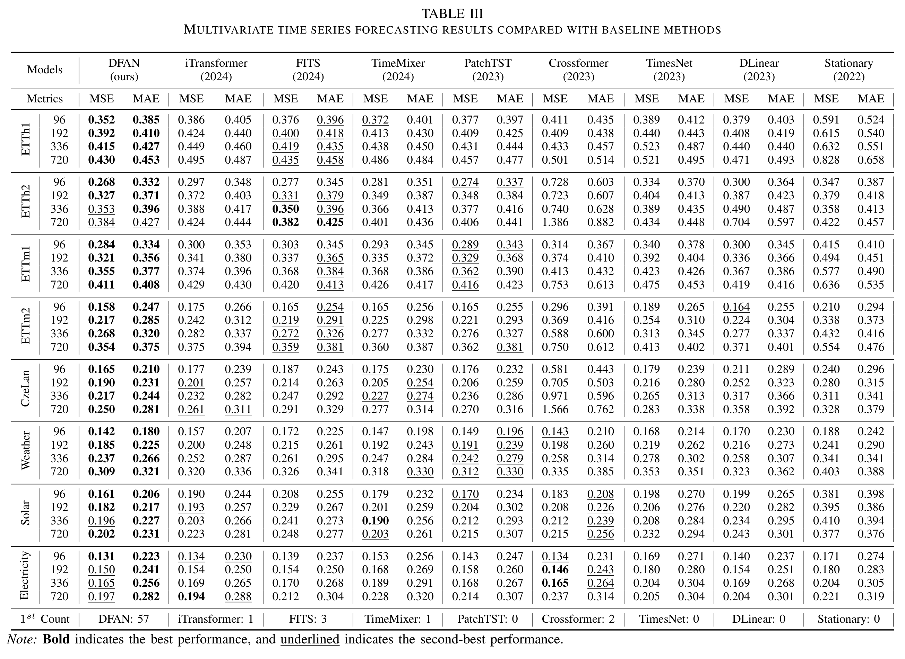
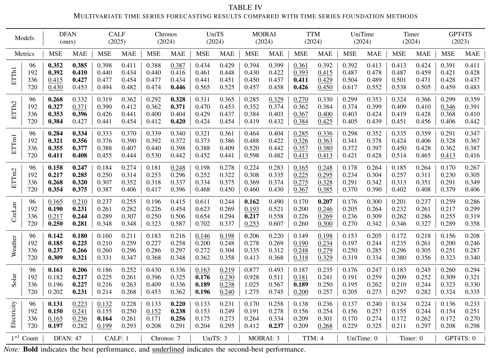
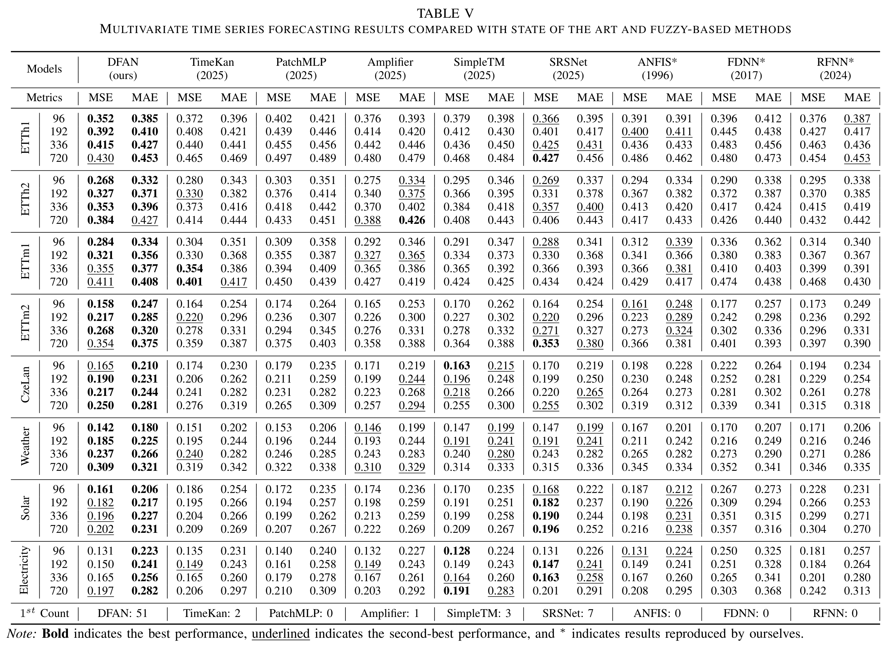

# DFAN: Dual-Path Fuzzy Attention Network for Time Series Forecasting

**Zhen Mei and Tao Zhao** · Sichuan University

Published in **IEEE Transactions on Fuzzy Systems** as an **Early Access** article.

DFAN is a PyTorch model for multivariate time series forecasting. It learns temporal dependencies across patches and relationships between variables in parallel, then fuses the two representations to forecast future values.

[Architecture](#architecture) · [Quick start](#quick-start) · [Run the benchmarks](#run-the-benchmarks) · [Results](#results) · [Citation](#citation)

## Architecture



*Figure 1 from the manuscript. The left panel shows patch construction, the center shows the forecasting network, and the right shows how fuzzy similarities become attention masks.*

- **Fuzzy similarity masking.** Time- and frequency-domain filtering precedes the computation of Gaussian fuzzy similarities. The resulting masks suppress noisy or redundant interactions in both attention paths.
- **Dual-path fuzzy attention.** One path models temporal relationships among non-overlapping patches and the other models relationships among channels. Learned weights combine the two representations.
- **Hierarchical fuzzy mixture of experts (HFMoE).** The router uses membership information from Takagi–Sugeno–Kang (TSK) fuzzy experts to select which experts process each input. A linear head maps the resulting representation to the forecast horizon.

## Quick start

Create a Conda environment with Python 3.11.13 and install the dependencies from the repository root. Git is needed to install `torchprofile` from its Git repository.

```bash
conda create -n dfan python=3.11.13 -y
conda activate dfan
python -m pip install -r requirements.txt
```

DFAN uses `torch.nn.RMSNorm`. You can check that your PyTorch build provides it and whether CUDA is available with the following command.

```bash
python -c "import torch; print(torch.__version__); print(torch.nn.RMSNorm); print(torch.cuda.is_available())"
```

Run one epoch on the included ETTh1 dataset with a 512-step look-back window and a 96-step forecast horizon.

```bash
python Main_DFAN.py
```

This entry point runs rolling evaluation after training. For the full training settings and all four horizons, use the dataset scripts below.

## Run the benchmarks

For benchmarks beyond the included ETTh1, download the preprocessed CSV files and extract them into `dataset/forecasting/`, alongside `FORECAST_META.csv`. [Google Drive](https://drive.google.com/file/d/1vgpOmAygokoUt235piWKUjfwao6KwLv7/view?usp=drive_link) · [Baidu Netdisk](https://pan.baidu.com/s/1ycq7ufOD2eFOjDkjr0BfSg?pwd=bpry)

From the repository root, run the script for the dataset you want to evaluate. Use Bash on Linux or macOS, or Git Bash or WSL on Windows.

```bash
bash scripts/multivariate_forecast/ETTh1_script/DFAN.sh
```

Each dataset script trains and evaluates DFAN separately for horizons of **96, 192, 336, and 720 time steps**. The rolling configuration defines the data splits, evaluation stride, and default seed (`2021`). [Rolling forecast configuration](config/rolling_forecast_config.json)

### Change a run

Edit the command for the desired horizon in the dataset script. Keep the two horizon values in sync when changing the forecast length.

| Setting | What it controls |
| --- | --- |
| `--data-name-list` | Dataset filename under `dataset/forecasting/` |
| `horizon` in `--strategy-args` and `--model-hyper-params` | Number of forecast steps used by evaluation and by the model |
| `seq_len` and `patch_len` | Look-back window and non-overlapping patch length. Choose a `patch_len` that divides `seq_len` evenly. |
| `num_epochs`, `batch_size`, and `lr` | Training epochs, batch size, and learning rate |
| `num_experts`, `k`, and `rule_size` | Expert count, number of selected experts, and fuzzy rules per expert |

### Find the outputs

- **Console and run logs.** Normalized MSE, MAE, and RMSE are printed to the console and written to `logs/DFAN/<dataset>/`.
- **Experiment workbook.** Each completed run adds a row with metrics, hyperparameters, and timing information to `result/excel/<dataset>/DFAN.xlsx`.

## Results

The tables below show the manuscript's MSE and MAE comparisons across eight benchmarks and four forecast horizons. Click a table to view it at full resolution.

### Baseline methods

[](assets/readme/comparison-baselines.png)

### Time series foundation models

[](assets/readme/comparison-foundation-models.png)

### State-of-the-art and fuzzy-based methods

[](assets/readme/comparison-recent-and-fuzzy-methods.png)

## Repository layout

| Path | Contents |
| --- | --- |
| [`Main_DFAN.py`](Main_DFAN.py) | One-epoch ETTh1 example |
| [`scripts/run_benchmark.py`](scripts/run_benchmark.py) | Training and rolling evaluation entry point |
| [`scripts/multivariate_forecast/`](scripts/multivariate_forecast/) | Dataset-specific commands and hyperparameters |
| [`config/`](config/) | Forecasting and evaluation configuration |
| [`ts_benchmark/baselines/dfan/`](ts_benchmark/baselines/dfan/) | DFAN model, similarity masks, fuzzy attention, and experts |

## Citation

If you use DFAN in your research, please cite the paper.

## Acknowledgments

The implementation builds on the Time Series Forecasting Benchmark and the Time-Series-Library. [TFB](https://github.com/decisionintelligence/TFB) · [Time-Series-Library](https://github.com/thuml/Time-Series-Library)

We thank the authors for making their code publicly available.
